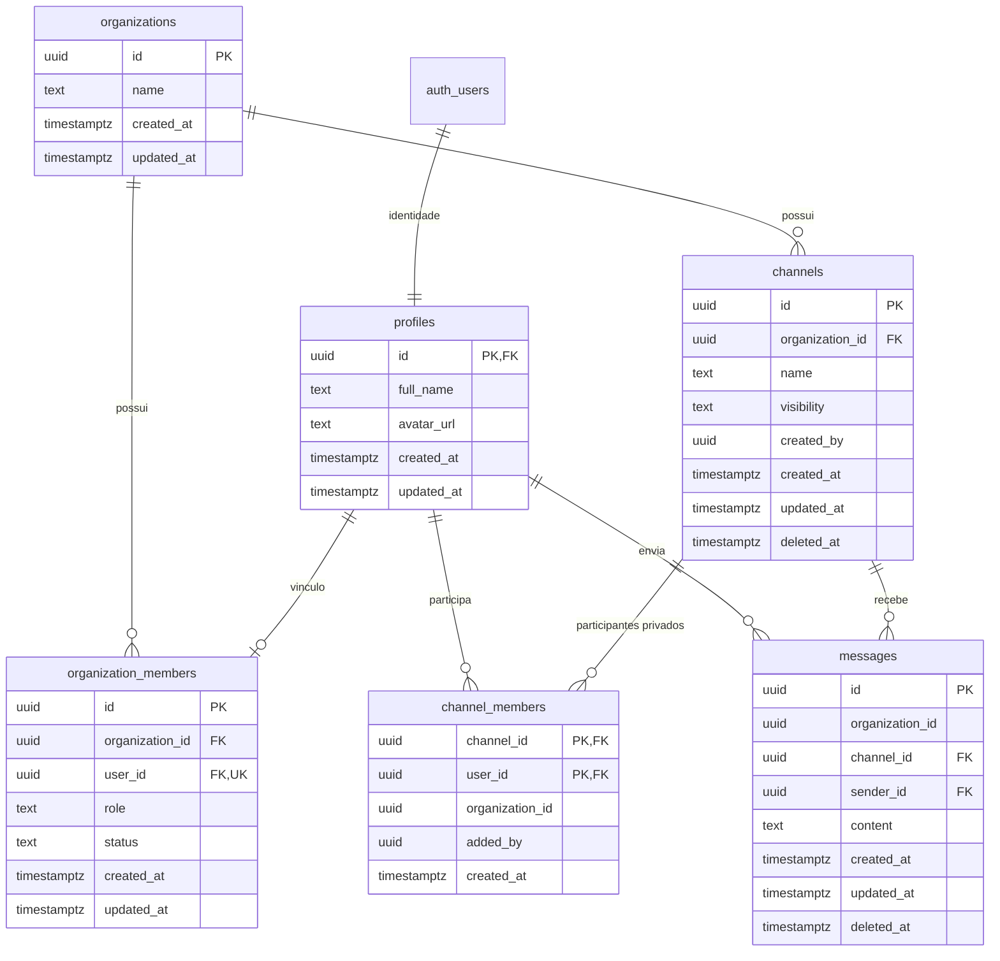

# Arquitetura inicial e modelo de dados — Connexa

## 1. Objetivo

Definir a arquitetura inicial do Connexa e o modelo de dados mínimo para suportar autenticação, isolamento entre empresas, perfis, papéis de usuário, canais públicos e privados e mensagens.

A aplicação terá experiência web mobile-first. A infraestrutura do projeto será exclusivamente online, utilizando GitHub, Supabase e Vercel.

## 2. Arquitetura proposta

- **Vercel:** hospedagem e deploy da aplicação web.
- **Supabase Auth:** autenticação e identidade dos usuários.
- **Supabase PostgreSQL:** persistência dos dados relacionais.
- **Supabase Row Level Security (RLS):** autorização e isolamento dos registros.
- **Supabase Realtime:** atualização de mensagens em tempo real, sujeita às mesmas regras de autorização.
- **GitHub:** versionamento do código, documentação e revisão das mudanças.

Não está previsto um servidor backend separado na primeira versão. A aplicação cliente utilizará os serviços do Supabase, sem expor credenciais privilegiadas. A chave `service_role` ou qualquer chave secreta nunca poderá ser disponibilizada no navegador.

## 3. Decisões de negócio aprovadas

1. Cada usuário pertence exclusivamente a uma empresa.
2. Cada empresa possui exatamente um `owner` ativo.
3. A transferência de propriedade é explícita e deve ocorrer de forma atômica.
4. Os papéis são `owner`, `admin` e `member`.
5. Existem canais públicos e privados.
6. Todos os membros ativos da empresa podem acessar canais públicos.
7. Canais privados só podem ser acessados por usuários explicitamente cadastrados como participantes.
8. `owner` e `admin` podem administrar canais privados sem receber acesso automático ao conteúdo das mensagens.
9. Para ler ou enviar mensagens em canal privado, `owner` e `admin` também precisam ser participantes.
10. Os dados de uma empresa não podem ser acessados por usuários de outra empresa.
11. Ao criar um canal privado, o criador será automaticamente cadastrado como participante em `channel_members`.

## 4. Modelo entidade-relacionamento

As seis tabelas próprias da aplicação são `organizations`, `profiles`, `organization_members`, `channels`, `channel_members` e `messages`. O Supabase também mantém `auth.users), tabela gerenciada pelo Supabase Auth.

## 5. Entidades e atributos

### 5.1 `organizations`

Representa uma empresa/organização.

| Campo | Tipo | Regra |
|---|---|---|
| `id` | UUID | Chave primária |
| `name` | TEXT | Obrigatório |
| `created_at` | TIMESTAMPTZ | Data de criação |
| `updated_at` | TIMESTAMPTZ | Última atualização |

### 5.2 `profiles`

Armazena informações complementares do usuário. O identificador é o mesmo de `auth.users.id), formando uma relação 1:1.

| Campo | Tipo | Regra |
|---|---|---|
| `id` | UUID | PK e FK para `auth.users.id` |
| `full_name` | TEXT | Nome de exibição |
| `avatar_url` | TEXT | URL opcional do avatar |
| `created_at` | TIMESTAMPTZ | Data de criação |
| `updated_at` | TIMESTAMPTZ | Última atualização |

### 5.3 `organization_members`

Relaciona usuários às empresas e armazena seu papel e situação. Um usuário terá no máximo um vínculo, garantindo a regra de uma empresa por usuário.

| Campo | Tipo | Regra |
|---|---|---|
| `id` | UUID | Chave primária |
| `organization_id` | UUID | FK para `organizations.id` |
| `user_id` | UUID | FK para `profiles.id`; UNIQUE |
| `role` | TEXT | `owner`, `admin` ou `member` |
| `status` | TEXT | `active` ou `suspended` |
| `created_at` | TIMESTAMPTZ | Data de entrada |
| `updated_at` | TIMESTAMPTZ | Última atualização |

Restrições e invariantes:

- `UNIQUE(user_id)` impede que o usuário pertença a duas empresas.
- `CHECK` restringe `role` aos três valores aprovados e `status` aos valores definidos.
- Um índice único parcial para `organization_id` com `role = 'owner'` e `status = 'active'` impede dois proprietários ativos na mesma empresa.
- A existência de pelo menos um proprietário ativo não é garantida por índice único. Deve ser garantida por operações transacionais controladas de criação da empresa, transferência de propriedade e suspensão/remoção de membros.
- A criação da empresa e de seu primeiro `owner` deve acontecer na mesma transação.
- A transferência deve validar o novo proprietário, atualizar os dois papéis na mesma transação e impedir estado intermediário sem proprietário.
- O proprietário atual não pode ser suspenso ou removido antes da transferência.

### 5.4 `channels`

Representa canais pertencentes a uma empresa.

| Campo | Tipo | Regra |
|---|---|---|
| `id` | UUID | Chave primária |
| `organization_id` | UUID | FK para a empresa |
| `name` | TEXT | Nome do canal |
| `visibility` | TEXT | `public` ou `private` |
| `created_by` | UUID | Usuário criador, membro da mesma empresa |
| `created_at` | TIMESTAMPTZ | Data de criação |
| `updated_at` | TIMESTAMPTZ | Última atualização |
| `deleted_at` | TIMESTAMPTZ | Exclusão lógica, quando aplicável |

Regras:

- Canal público: todos os membros ativos da empresa podem visualizar o canal e suas mensagens.
- Canal privado: somente participantes cadastrados em `channel_members` podem visualizar o conteúdo e enviar mensagens.
- `owner` e `admin` podem administrar metadados e participantes sem que isso conceda acesso às mensagens.
- Ao criar um canal privado, o criador deve ser inserido automaticamente em `channel_members` na mesma operação transacional de criação do canal. Sua permissão de leitura decorre desse vínculo explícito, e não de uma exceção baseada no papel de criador.

### 5.5 `channel_members`

Armazena os participantes autorizados dos canais privados. Canais públicos não precisam gerar uma linha para cada membro da empresa.

| Campo | Tipo | Regra |
|---|---|---|
| `channel_id` | UUID | FK para o canal |
| `user_id` | UUID | FK para o membro da empresa |
| `organization_id` | UUID | Usado para validar a consistência entre empresa, canal e membro |
| `added_by` | UUID | Usuário que adicionou o participante |
| `created_at` | TIMESTAMPTZ | Data de inclusão |

Restrições:

- Chave primária composta: `(channel_id, user_id)`.
- Chaves estrangeiras compostas devem garantir que o canal e o usuário estejam associados à mesma `organization_id).
- A aplicação deverá impedir a criação de participantes para canais públicos, salvo se uma necessidade futura justificar esse comportamento.
- Remover um participante revoga seu acesso às mensagens do canal a partir da avaliação das políticas de acesso.

### 5.6 `messages`

Armazena mensagens enviadas nos canais.

| Campo | Tipo | Regra |
|---|---|---|
| `id` | UUID | Chave primária |
| `organization_id` | UUID | Empresa do canal |
| `channel_id` | UUID | Canal da mensagem |
| `sender_id` | UUID | Autor, membro da mesma empresa |
| `content` | TEXT | Conteúdo textual obrigatório |
| `created_at` | TIMESTAMPTZ | Data de envio |
| `updated_at` | TIMESTAMPTZ | Última edição, quando aplicável |
| `deleted_at` | TIMESTAMPTZ | Exclusão lógica, quando aplicável |

Restrições:

- Chaves estrangeiras compostas devem garantir que canal e autor pertençam à mesma empresa.
- O autor deve ser membro ativo da empresa no momento do envio.
- A autorização de leitura deve seguir a visibilidade e as regras de participação do canal.
- A autorização de envio deve seguir as mesmas regras de acesso, além de validar o autor.

## 6. Relacionamentos e cardinalidades

| Relacionamento | Cardinalidade | Descrição |
|---|---|---|
| `auth.users` → `profiles` | 1:1 | Um perfil por identidade autenticada |
| `profiles` → `organization_members` | 1:0..1 | Um usuário pode ter no máximo um vínculo com empresa |
| `organizations` → `organization_members` | 1:N | Uma empresa possui membros |
| `organizations` → `channels` | 1:N | Uma empresa possui canais |
| `channels` → `channel_members` | 1:N | Um canal privado possui participantes |
| `profiles` → `channel_members` | 1:N | Um usuário pode participar de vários canais |
| `channels` → `messages` | 1:N | Um canal recebe mensagens |
| `profiles` → `messages` | 1:N | Um usuário pode enviar mensagens |

## 7. Matriz de permissões

| Ação | Owner | Admin | Member |
|---|---:|---:|---:|
| Visualizar membros da empresa | Sim | Sim | Sim |
| Convidar membros | Sim | Sim | Não |
| Alterar papéis de membros, exceto regras de owner | Sim | Sim | Não |
| Remover/suspender membros, exceto o owner | Sim | Sim | Não |
| Transferir propriedade | Sim | Não | Não |
| Criar canais | Sim | Sim | Não |
| Editar/excluir canais | Sim | Sim | Não |
| Gerenciar participantes de canais privados | Sim | Sim | Não |
| Visualizar canais públicos | Sim | Sim | Sim |
| Enviar mensagens em canais públicos | Sim | Sim | Sim |
| Ler mensagens privadas | Se participante | Se participante | Se participante |
| Enviar mensagens privadas | Se participante | Se participante | Se participante |

A administração de metadados e participantes de canais privados é distinta da leitura de mensagens. A política de leitura de `messages` não deve conceder acesso amplo com base apenas no papel `owner` ou `admin`.

## 8. Estratégia de isolamento multiempresa

O isolamento será aplicado em camadas:

1. `organization_members` associa a identidade autenticada à única empresa do usuário.
2. Registros de canais, participantes e mensagens carregam ou referenciam a empresa proprietária.
3. Chaves estrangeiras compostas impedem relações entre registros de empresas diferentes.
4. RLS será habilitado em todas as tabelas expostas pelo schema público.
5. As políticas utilizarão a identidade autenticada (`auth.uid()`) e os vínculos ativos em `organization_members` para autorizar operações.
6. O cliente não poderá definir ou trocar livremente `organization_id`, `user_id`, `sender_id` ou `role` para obter privilégios.
7. Operações privilegiadas, como transferência de propriedade, serão transacionais, terão validação de autorização e permissões de execução restritas.
8. As mesmas regras serão validadas para consultas e eventos em tempo real.

### Regras essenciais de RLS

- **Organizations e membros:** usuário autenticado só consulta os dados da própria empresa, conforme seu vínculo e permissões.
- **Channels:** membros ativos consultam canais públicos da empresa; canais privados exigem participação para acesso ao canal como conteúdo. `owner` e `admin` recebem acesso administrativo restrito aos metadados necessários para gerenciar canais, sem leitura automática das mensagens.
- **Channel members:** participantes e administradores autorizados podem consultar ou alterar a lista conforme a operação permitida, sempre dentro da própria empresa.
- **Messages:** SELECT e INSERT exigem acesso ao canal. Para canais privados, a condição obrigatória é a participação explícita; papel administrativo isolado não satisfaz essa condição.
- **UPDATE e DELETE:** exigem políticas próprias, com validação de autorização tanto na linha original quanto nos novos valores quando aplicável.

As políticas finais devem ser testadas com usuários de empresas diferentes e com combinações de papéis e participação. Não utilizar `user_metadata` editável pelo usuário como fonte de autorização.

## 9. Convenções técnicas

| Item | Convenção |
|---|---|
| Identificadores | UUID |
| Tabelas e colunas | `snake_case` |
| Nomes de tabelas | Plural |
| Datas | `TIMESTAMPTZ`, armazenadas em UTC |
| Criação | `created_at` |
| Atualização | `updated_at` |
| Exclusão lógica | `deleted_at`, somente quando houver necessidade de preservar histórico |
| Papel | `owner`, `admin`, `member` |
| Status de membro | `active`, `suspended` |
| Visibilidade de canal | `public`, `private` |

Índices deverão ser definidos para FKs e consultas frequentes, especialmente mensagens por canal ordenadas por data, canais por empresa e participantes por canal/usuário.

## 10. Realtime

A entrega de mensagens em tempo real deverá respeitar a mesma autorização aplicada à leitura das mensagens. A implementação deverá validar o comportamento do mecanismo Realtime escolhido no Supabase, incluindo usuários que entram ou saem de canais privados e usuários suspensos. Não considerar o recebimento de um evento como uma autorização independente.

## 11. Fora do escopo da primeira versão

- Mensagens diretas entre usuários.
- Chamadas de áudio ou vídeo.
- Upload e compartilhamento de anexos.
- Threads e respostas encadeadas.
- Notificações avançadas.
- Busca avançada e histórico com recursos adicionais.

## 12. Pontos a confirmar antes da implementação

1. **Gestão de membros:** detalhar o fluxo de convite, aceite e suspensão, sem permitir vínculo de um usuário a mais de uma empresa.
2. **Exclusão e retenção:** definir por quanto tempo mensagens e canais excluídos logicamente serão mantidos.
3. **Políticas RLS e Realtime:** escrever e testar as políticas concretas antes de liberar o acesso pelo cliente.

## 13. Critérios de aceite da Issue #37

- [x] Entidades e relacionamentos principais identificados.
- [x] Cardinalidades documentadas.
- [x] Estratégia de isolamento entre empresas definida.
- [x] Papéis e permissões iniciais definidos.
- [x] Canais públicos e privados definidos.
- [x] Política de privacidade para mensagens privadas definida.
- [x] Regra de inclusão automática do criador como participante de canal privado definida.
- [x] Convenções de nomes, chaves e timestamps definidas.
- [ ] Documento revisado e aprovado pela equipe.
- [ ] Modelo físico e políticas RLS implementados em etapa própria.

## 14. Referências

- [Supabase Row Level Security](https://supabase.com/docs/guides/database/postgres/row-level-security)
- [Supabase Auth](https://supabase.com/docs/guides/auth)
- [Supabase Realtime](https://supabase.com/docs/guides/realtime)

---

**Observação:** este documento registra a arquitetura e as decisões de modelagem. Ele não representa a execução de migrations, criação de tabelas ou configuração de políticas no projeto Supabase.
